# Level 3: Adapter components

`sdp-adapters` holds every real implementation of a driven port. Its one structural rule is that every remote call goes through the archive `Transport` (ADR-015, deviation D20): no adapter opens a socket, uses astroquery, pyvo or a daschlab session of its own. That single seam is what lets a test replace the network with a cassette without stubbing anything an adapter owns, and it is the BDD seam for every archive scenario.

```mermaid
flowchart TB
    subgraph ports ["Kernel driven ports"]
        direction LR
        pa["ArchiveGateway · CrossMatchService ·<br/>ObservationArchiveGateway · ObjectResolver ·<br/>SourceRegistry · CapabilityDiscoveryService"]
        pp["ProductInventory · ProductNormalizer ·<br/>ProductValidator · ProductDialect"]
        ps["Repositories · EventLog · ArtifactStore ·<br/>Ledger · BundlePublisher · ComputeExecutor"]
    end

    subgraph archives ["sdp.adapters.archives"]
        direction TB
        tap["tap · adql · votable<br/>TAP queries and VOTable parsing"]
        mast["mast · mast_inventory<br/>ObsCore, products by obs_id/file"]
        simbad["simbad · xmatch · dasch"]
        reg["registry · vo · capabilities<br/>RegTAP, VOSI, capability scan"]
        dialect["dialect + dialects/*.yaml<br/>column mapping per release"]
        untrusted["untrusted · isolated_parse<br/>validate before parse (NFR-009)"]
        transport["transport<br/>UrllibTransport · PoliteTransport ·<br/>CassetteTransport (replay | record)"]
    end

    subgraph others ["Other adapters"]
        direction TB
        products["products: fits · jwst · validator"]
        pg["postgres: repositories, migrations"]
        nas["storage.nas · analytics.duckdb"]
        git["ledger.git"]
        zen["publication.zenodo"]
        cpu["compute.cpu · compute.clustering ·<br/>imaging.photutils_detector · imaging.tweakwcs_refiner"]
    end

    net[/"Archives on the network"/]
    cassettes[("python/tests/cassettes<br/>committed recordings")]

    tap --> transport
    mast --> transport
    simbad --> transport
    reg --> transport
    tap --> untrusted
    mast --> untrusted
    tap --> dialect
    transport -- "production" --> net
    transport -- "CI, BDD, contract tests" --> cassettes

    archives -- "implements" --> pa
    products -- "implements" --> pp
    others -- "implements" --> ps

    style transport fill:#1168bd,color:#fff,stroke:#0e5aa7
    style untrusted fill:#438dd5,color:#fff,stroke:#3c7fc0
    style net fill:#999,color:#fff,stroke:#888
    style cassettes fill:#999,color:#fff,stroke:#888
    style archives fill:none,stroke:#1168bd,stroke-width:2px
    style others fill:none,stroke:#1168bd,stroke-width:2px
    style ports fill:none,stroke:#999,stroke-width:2px,stroke-dasharray:5
```

| Rule | Why | Enforced by |
|---|---|---|
| HTTP only through `Transport` | One seam to record, replay and rate-limit | review, D20, DSI-007 |
| CI never makes a live archive call | Reproducible, offline CI | `CassetteTransport` raises `CassetteMissing` in replay mode |
| Cassettes are recorded, never hand-written | A hand-written cassette tests the author's belief, not the archive | weekly live job writes them; review |
| Downloads are validated before parsing | Untrusted bytes | `untrusted.validate_votable`, NFR-009 |
| Adapters never import each other | Swappable implementations | import-linter |
