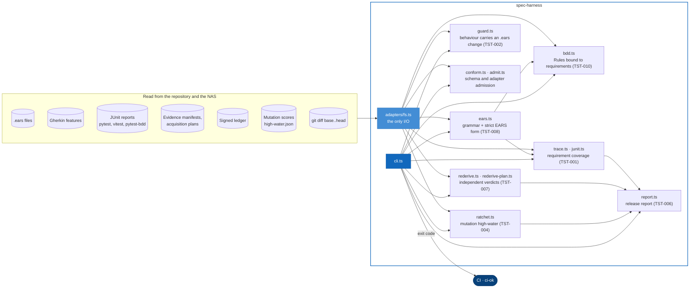

# Level 3: Harness components

`spec-harness` is the independent reader. It never imports the Python side and never trusts the kernel's verdict: it compiles the requirements, joins them to test results, re-derives every verdict and acquisition plan from the manifests, and refuses a release report that claims more than the run proved. It is hexagonal too: the commands are pure functions over ports, and `adapters/fs.ts` is the only file that touches the disk.

Every command has a test under `typescript/packages/spec-harness/test` that feeds it a bad input and expects a failure: that negative case is what makes the gate real (see [the stance](../testing.md#the-stance)).
