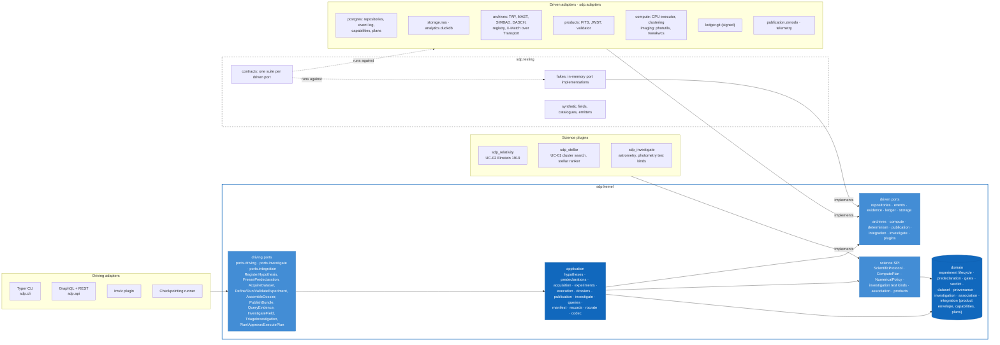

# Level 3: Kernel components

The kernel is a hexagon. Driving adapters call use cases through the driving ports on the left; driven ports on the right are implemented by `sdp-adapters` in production and by the fakes in `sdp.testing` under test; science plugins arrive from above through the science SPI. The same contract suite (`sdp.testing.contracts`) runs against a port's fake and its real adapter, so a fake cannot pass what the adapter fails (TST-003).

## Dependency rule

Enforced by import-linter (T0, §11.3):

- `domain` imports nothing above it.
- `application` imports `domain`, `ports` and `science`.
- Science plugins import only `sdp.kernel.domain` and `sdp.kernel.science`.
- Adapters never import each other; only the composition roots (`sdp.cli`, `sdp.api`, `sdp.adapters.bootstrap`) import adapters.
- Nothing under `domain`, `application` or `science` uses `unittest.mock` (TST-005); the doubles are the fakes.

## What each component is tested by

| Component | Tier | Where | Mutation target |
|---|---|---|---|
| domain | T1 unit, T2 property | `python/tests/unit/kernel`, `python/tests/property`, `python/tests/investigate`, `python/tests/association` | `sdp-kernel-domain` |
| science SPI | T1, T4 | `python/tests/unit/kernel`, `python/tests/usecase`, `python/tests/investigate`, `python/tests/archives` | `sdp-kernel-science` |
| application | T4 use case on fakes, BDD | `python/tests/usecase`, `python/tests/bdd` | `sdp-kernel-application` |
| driven ports | T3 contract | `python/tests/contract` (fakes), `python/tests/integration` (real) | — |
| plugins | T1, T8 scientific | `python/tests/relativity`, `python/tests/stellar` | `sdp-relativity-*`, `sdp-stellar-*` |

The [testing strategy](../testing.md) explains each tier and the signal that proves it can fail.
