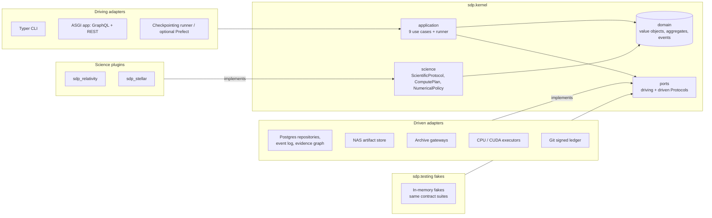

# Kernel components

Driving adapters call use cases from the left, driven adapters implement ports on the right, science modules plug in from above through `ScientificProtocol`, and the fakes at the bottom implement the same driven ports under the same contract suite.

Dependency rule (enforced by import-linter, §11.3): domain imports nothing above it; application imports domain and ports; science modules import only `sdp.kernel.domain` and `sdp.kernel.science`; adapters never import each other; only composition roots import adapters.
