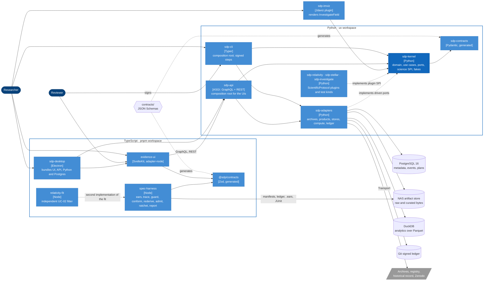

# Level 2: Containers

Python owns the science and the evidence it produces; TypeScript checks that evidence independently and shows it to people. The two sides share one thing, `contracts/`, and both generate their types from it. Archives and the historical record enter only through `sdp-adapters`.

| Container | Owns | Must not | Enforced by |
|---|---|---|---|
| `sdp-kernel` | Domain, use cases, ports, the science SPI, the fakes in `sdp.testing` | Import an adapter, a framework or I/O library | import-linter (T0), NFR-006, TST-005 |
| science plugins | Protocols, test kinds, oracles | Import anything but `sdp.kernel.domain` and `sdp.kernel.science` | import-linter |
| `sdp-adapters` | Every driven port's real implementation | Import another adapter; parse a download before `untrusted.validate_votable` | import-linter, NFR-009 |
| `sdp-cli`, `sdp-api` | Wiring adapters to use cases | Hold business rules | review; use-case tests (T4) run without them |
| `spec-harness` | An independent reading of manifests, ledger and requirements | Import the Python side; trust the kernel's verdict | dependency-cruiser, TST-007 |
| `evidence-ui`, `sdp-desktop` | Presentation; unsigned commands | Sign anything (INV-015) | e2e tests |
| `contracts/` | Every boundary type, once | Be hand-written in either language | CTR-001, CTR-002 |

The [kernel components](components.md), [adapter components](components-adapters.md) and [harness components](components-harness.md) open the three containers that carry the most rules.
