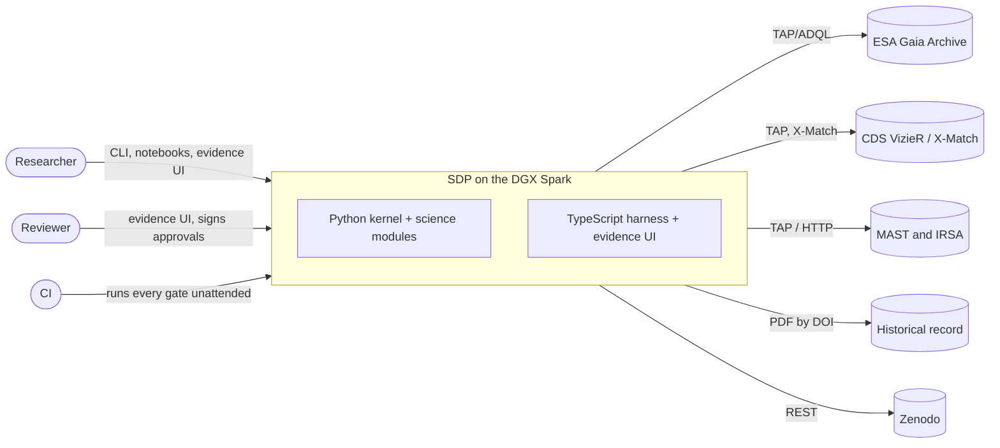

# System context

SDP is one host running a Python kernel, a TypeScript harness and UI, PostgreSQL and a NAS; it reaches outward only to public archives, the historical record and Zenodo.

| External system | Protocol | Adapter |
|---|---|---|
| ESA Gaia Archive | TAP/ADQL | `GaiaTapArchiveAdapter` |
| CDS VizieR / X-Match | TAP, X-Match HTTP | `VizierArchiveAdapter`, `CdsXMatchAdapter` |
| MAST and IRSA | TAP / HTTP | `MastArchiveAdapter`, `IrsaArchiveAdapter` |
| Historical record | PDF by DOI | `FilesystemHistoricalSources` |
| Zenodo | REST | `ZenodoPublisherAdapter` |
