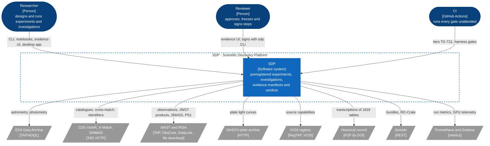

# Level 1: System context

SDP is one host (the DGX Spark, or a Windows desktop for a single scientist) running a Python kernel, a TypeScript harness and two user interfaces. It reaches outward only to public archives, the VO registry, the historical record, Zenodo and the metrics stack, and every one of those calls goes through an adapter behind a kernel port.

| External system | Protocol | Adapter (in `sdp.adapters`) | How tests reach it |
|---|---|---|---|
| ESA Gaia Archive | TAP/ADQL | `archives.tap` with the `gaia-dr3` dialect | Cassettes through `CassetteTransport`; weekly live smoke (T11) |
| CDS VizieR, X-Match, SIMBAD | TAP, HTTP | `archives.tap`, `archives.xmatch`, `archives.simbad` | Cassettes; weekly live smoke |
| MAST and IRSA | TAP, ObsCore, DataLink, HTTP | `archives.mast`, `archives.mast_inventory`, `products.jwst` | Cassettes and reference recordings |
| DASCH | HTTP | `archives.dasch` | Cassettes |
| IVOA registry | RegTAP, VOSI | `archives.registry`, `archives.vo`, `archives.capabilities` | Cassettes |
| Historical record | PDF by DOI | `historical.filesystem` | Fixture files; transcriptions are human-verified |
| Zenodo | REST | `publication.zenodo` | Recorded exchanges; sandbox publish by hand |
| Prometheus and Grafana | metrics | `telemetry.prometheus` | Integration tier |

Every remote call goes through the archive `Transport` (ADR-015), so a test swaps the network for a cassette at one seam and nothing else.
