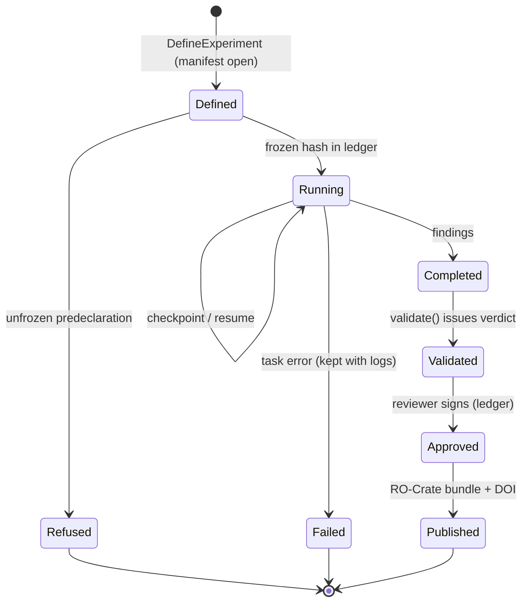

# Experiment lifecycle

No experiment runs without a frozen predeclaration. A resumed experiment re-enters Running from its last checkpoint; Refused and Failed are terminal but retained with their manifests, and only a Validated experiment with a signed approval reaches Published.

