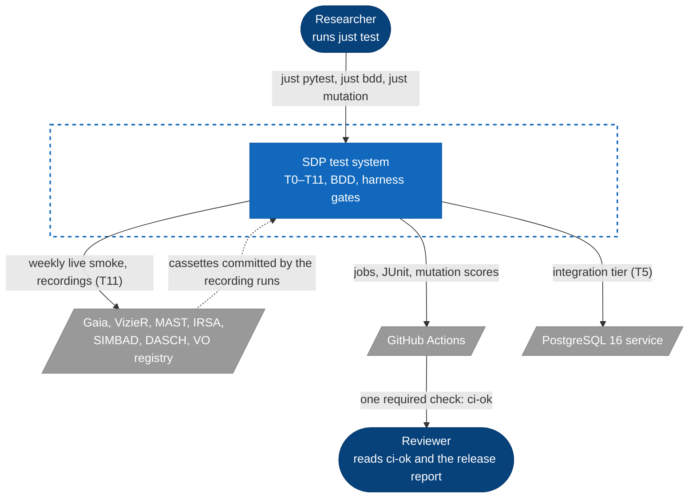
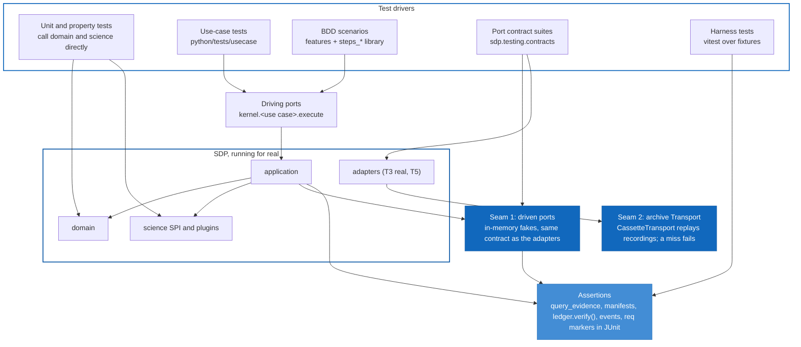

# Testing

**Implements:** §11 of the [architecture specification](architecture.md), and the testing requirements TST-001 to TST-010 in [`requirements/testing/quality.ears`](../requirements/testing/quality.ears).

How SDP is tested: what each tier owns, where it lives, how to run it, where CI runs it, and the signal that proves it can fail. The shape follows [ESI.ts](https://github.com/lgriffin/ESI.ts/blob/master/guides/TESTING.md), adapted to a platform where the thing under test is scientific evidence: a verdict, a manifest, a ledger entry. Line coverage is reported but never gates a merge. Requirement coverage, mutation score and clean-room reproduction do.

## The stance

Four positions explain every choice below.

1. **A tier that cannot fail manufactures confidence.** Each tier owns one class of failure and carries a signal that proves it can go red: a negative fixture, a killed mutant, a known-weak test, a drifted Rule. A green run from a tier with no such signal says nothing, so a tier without one is listed as a probe, not counted as protection.
2. **Every gate is a one-way ratchet.** Mutation high-water marks, requirement statuses and shrink-only exception lists move in one direction. A mark is never written by hand and never lowered; a requirement moves from draft to approved, never back, except to retired.
3. **The specification executes.** Behaviour is stated as EARS requirements in `requirements/**/*.ears`, one obligation of one named system per requirement. Each approved requirement is verified by tests that carry its id, and the BDD tier states the most important ones as Gherkin Rules whose title is the requirement's exact text. The harness fails a build in which a requirement has no passing test, a Rule drifts from its requirement, or a behaviour change arrives without a requirement change.
4. **Fakes over mocks, one seam per boundary.** Nothing under `domain`, `application` or the science modules uses a mock (TST-005). A test replaces infrastructure at one of two seams only: the kernel's driven ports, through the fakes in `sdp.testing` (which pass the same contract suite as the real adapters, TST-003), or the archive `Transport`, through committed cassettes. Everything between a driving port and that seam runs for real, so a test can fail for a bug anywhere in it.

## Where the suite stands

Measured on 2026-10-29 on `main` at `b745e3a` plus this change, on a 4-core machine.

| Command | Collected | Notes |
|---|---:|---|
| `just pytest` (Python T0–T4, T6, T8 synthetic) | 921 | 89 deselected: integration, live, GPU |
| of which BDD, `python/tests/bdd` | 12 | 6 scenarios over 5 requirements, 6 runner self-tests |
| `just integration` (T5, needs PostgreSQL) | 89 | |
| `pnpm test` (vitest, every TypeScript package) | 11 files in `spec-harness` alone | |
| `pnpm --filter @sdp/e2e test` (Playwright) | 2 specs | |

| Specification | Count |
|---|---:|
| Requirements (`spec-harness ears`) | 100, 0 problems under the strict form (TST-008) |
| Approved | 96 |
| Bound to a Gherkin Rule (`spec-harness bdd`) | 11 |

| Mutation score | v0.1.0 release run | This change, local | Goal |
|---|---:|---:|---:|
| `sdp-kernel-science` | 12.65% | **100%** (328/328) | 90 |
| `sdp-kernel-application` | 67.78% | measuring | 90 |
| `sdp-kernel-domain` | 55.90% | measuring | 90 |
| `sdp-kernel-integration` (new target) | not scored | measuring | 90 |
| `@sdp/relativity-fit` | 85.41% | — | 90 |
| `sdp-relativity-1..5`, `sdp-stellar-1..3` | timed out at 180 min | — | 90 |
| `@sdp/spec-harness` | failed (fixed in #40) | — | 90 |

Most of the science gap was not weak tests but the wrong tests: the target ran only the unit and property suites, while the investigation, planner and product modules are exercised from the use-case, investigate, archive and product suites. A mutant no selected test reaches counts as a survivor. Selecting every suite that drives the kernel (`KERNEL_TESTS` in `python/tools/mutation.py`) took the score to 78.2%; 23 targeted tests in `python/tests/unit/kernel/test_science_spi.py` and two small refactors that removed equivalent mutants took it to 100%.

`mutation/high-water.json` is still empty: no run so far recorded marks, so the ratchet protects nothing yet. The first complete run after this change should be dispatched with `update` and its marks reviewed (see [Seeding the marks](#seeding-the-marks)).

## The tiers

Twelve tiers from §11.1 plus the harness gates and the BDD tier. Each owns one class of failure.

| Tier | Owns | Location | Command | Where CI runs it | Signal that it can fail |
|---|---|---|---|---|---|
| T0 Architecture | Import graph, package boundaries, no mocks in the kernel | `python/tests/architecture`, import-linter, dependency-cruiser | `just lint`, `pnpm lint` | `python-static`, `static-contracts` | `test_architecture` fails on a planted forbidden import |
| T1 Domain unit | Value objects, aggregates, science functions | `python/tests/unit`, `typescript/packages/*/test` | `just pytest tests/unit` | `python-fast`, `ts-fast` | Mutation score per target |
| T2 Property and metamorphic | Invariants across generated inputs (§11.4) | `python/tests/property` | `just pytest tests/property` | `python-fast` | Hypothesis shrinks a counterexample; mutation |
| T3 Port contract | Every fake and real adapter against one suite per port | `sdp.testing.contracts`, `python/tests/contract`, `python/tests/integration` | `just pytest tests/contract` | `python-fast` (fakes), `python-integration` (real) | The same suite fails a real adapter and its fake alike (TST-003) |
| T4 Use case | Application services wired to fakes | `python/tests/usecase` | `just pytest tests/usecase` | `python-fast` | Mutation of `sdp-kernel-application` |
| BDD (T4 seam) | Requirements as executable Rules | `python/tests/bdd` | `just pytest tests/bdd`, `just bdd` | `python-fast`, `static-contracts` | `spec-harness bdd` fails a drifted or empty Rule; the runner fails an undefined or ambiguous step |
| T5 Integration | Adapters against PostgreSQL, filesystem, DuckDB, cassettes | `python/tests/integration`, `python/tests/archives` | `just integration` | `python-integration` | A cassette miss raises `CassetteMissing`; a real adapter fails its port contract |
| T6 Cross-language | Golden fixtures, generated-code drift, GraphQL schema, manifests through the harness | `contracts/fixtures`, `python/tests/contracts`, `typescript/packages/contracts/test` | `just contracts`, `just cross-language` | `contracts-codegen`, `cross-language` | Every fixture under `fixtures/invalid` must be rejected at its expected path (CTR-003) |
| T7 End to end | Synthetic experiment from acquisition to UI | `typescript/packages/e2e`, `infrastructure/t7.sh` | `pnpm --filter @sdp/e2e test` | `e2e`; nightly | Playwright asserts on rendered evidence |
| T8 Scientific validation | Oracles, null, injection, independent implementation | `-m scientific` in `python/tests/relativity`, `python/tests/stellar` | `just pytest --tier T8` | `python-fast` (synthetic), nightly | An oracle without a verification record fails the test that uses it |
| T9 Reproducibility | Clean-room `reproduce.sh` in a fresh container | `infrastructure/reproduce.sh` | `just reproduce` | release | The harness refuses a level whose tier did not pass (TST-006) |
| T10 Mutation | Strength of T1–T4 and the BDD tier | `python/tools/mutation.py`, Stryker configs | `just mutation <target>`, `npx stryker run` | weekly `mutation.yml`, release | The known-weak fixture must lose a mutant and keep a survivor (TST-009), on every pull request |
| T11 Live archive smoke | One small query per adapter; schema drift | `-m live` | `archive-smoke.yml` | weekly | A live response of the wrong shape fails; counts as a probe |
| Harness gates | Requirements compile, coverage, guard, re-derivation, ratchet, release report | `typescript/packages/spec-harness` | `pnpm harness <command>` | `static-contracts`, `trace`, `guard`, `cross-language`, release | Each command has a negative test in `spec-harness/test` |

## The test system in C4

Three views, in the notation of [`docs/c4`](c4/README.md).

### Level 1: Context

Who runs the tests and what the suite reaches outside itself. Only the live smoke (T11) and the recordings workflow reach an archive, and only when dispatched or scheduled; every other tier answers from cassettes.



### Level 2: Containers

Each tier is a container with its own runner and trigger. A tier moves right as it gets slower: what does not fit a pull request runs weekly or at release and gates the next pull request through a ratchet file rather than by blocking.

```mermaid
flowchart LR
    subgraph local ["Local: just"]
        direction TB
        jl["just lint · just pytest · just bdd"]
        jm["just mutation <target> --keep DIR"]
    end

    subgraph pr ["Pull request, gate: ci-ok"]
        direction TB
        static["static-contracts: ears (TST-008), bdd (TST-010), ESLint, dependency-cruiser"]
        pystatic["python-static: ruff, mypy strict, import-linter (T0)"]
        fast["python-fast: T1–T4, BDD, T6, T8 synthetic"]
        fixture["mutation-fixture: the pipeline can go red (TST-009)"]
        integ["python-integration: T3 real, T5 on PostgreSQL"]
        ts["ts-fast · e2e · viewer · desktop-windows"]
        cross["cross-language: manifests through the harness (T6, TST-007)"]
        guard["guard: behaviour carries an .ears change (TST-002)"]
        trace["trace: every approved requirement has a passing test (TST-001)"]
    end

    subgraph weekly ["Weekly"]
        direction TB
        mut["Mutation: mutmut per target and shard, Stryker per package, ratchet (T10)"]
        smoke["Archive live smoke (T11)"]
    end

    subgraph nightly ["Nightly"]
        direction TB
        n7["T7 end to end, T8 scientific on CPU"]
    end

    subgraph release ["Release"]
        direction TB
        t9["T9 clean-room reproduction"]
        rmut["T10 scores of the tagged commit"]
        report["Release report: levels only where tiers passed (TST-006)"]
    end

    local --> pr
    pr --> release
    weekly -- "high-water.json, cassettes, reviewed by PR" --> pr

    style local fill:none,stroke:#1168bd,stroke-width:2px
    style pr fill:none,stroke:#1168bd,stroke-width:2px
    style weekly fill:none,stroke:#999,stroke-width:2px,stroke-dasharray:5
    style nightly fill:none,stroke:#999,stroke-width:2px,stroke-dasharray:5
    style release fill:none,stroke:#999,stroke-width:2px
```



### Level 3: Components of a test run

How a test reaches the code. Everything above the seams is test-owned; everything between them is the real platform.



## Requirements (EARS)

Requirements are data: one `.ears` file per capability under `requirements/`, compiled by `spec-harness ears` into `reports/requirements/requirements.md`. The format and lifecycle are in [`requirements/README.md`](../requirements/README.md).

### The strict form (TST-008)

`spec-harness ears` rejects a requirement unless its text:

- follows its declared pattern: ubiquitous (`The <system> shall ...`), event (`When ..., the <system> shall ...`), state (`While ...`), unwanted (`If ..., then the <system> shall ...`), optional (`Where ...`) or complex;
- says `shall` exactly once: one requirement, one obligation;
- names the system that acts, as `the <system> shall`: the kernel, the harness, the platform, the association service, the stellar module, the CI pipeline. Passive text ("Logs shall be structured") names no one who can be held to it;
- contains no vague or optional wording: should, may, might, could, appropriate, adequate, sufficient, reasonable, robust, efficient, flexible, user-friendly, quickly, as needed, if possible, where possible, and/or, etc, TBD.

An obligation may list several closely related responses ("shall keep credentials outside Git, run containers as a non-root user, and validate downloads"), provided one test can verify all of them. When two systems are obliged, or two tests are needed, it is two requirements.

**Exclusions are requirements too.** What SDP deliberately does not do is written as an unwanted-behaviour requirement with a negated response, `If <condition>, then the <system> shall not <response>`, verified by a test that proves the absence. KRN-009 (`... then the kernel shall not issue VERIFIED`) is the model. An exclusion stated only in prose protects nothing.

### Traceability (TST-001, TST-002)

- Every test carries its requirement: `@pytest.mark.req("KRN-002")` in Python, `it("[KRN-002] ...")` in TypeScript, and in the BDD tier the Rule's id.
- `spec-harness trace` joins JUnit from both toolchains to the requirements and fails when an approved, test-verified requirement in scope has no passing test, or a marker names an unknown id.
- `spec-harness guard` fails a pull request that adds a use case, port, adapter or gate without touching an `.ears` file.

## TDD

Every behaviour change is written Red, Green, Refactor, and the requirement comes first:

1. **Requirement.** Add or amend the requirement in its `.ears` file, as `draft`, in the strict form. `just ears` must pass.
2. **Red.** Write the test that names it (`@pytest.mark.req("ID")`) and watch it fail for the right reason: the assertion, not an import error. For behaviour a scientist would describe, write the Gherkin Rule first (below).
3. **Green.** The smallest change in `domain`, `science` or `application` that passes it.
4. **Refactor.** With the suite green, remove duplication; then run `just mutation <target> --keep /tmp/mut` for the target you touched and kill or explain each survivor in the changed code.
5. **Approve.** In the same pull request, flip the requirement to `approved`. From then on `trace` fails the build if no passing test carries its id.

Conventions (§11.2, §11.8):

- Name a test after the behaviour it protects: `test_experiment_refuses_unfrozen_predeclaration`, not `test_run_2`.
- Assert the exact value or message (`pytest.raises(PlanInvalid, match=r"^task ids must be unique$")`), not that something was raised: a bare `raises` lets a mutant that empties the message survive.
- Numerical comparisons use the `NumericalPolicy` of the TaskKind under test, never an ad-hoc tolerance.
- Seeds are explicit. A value that reproducibility depends on, like `task_seed`, is pinned with golden values so a change to it fails loudly.
- Doubles are the fakes in `sdp.testing`. A test that needs a double the fakes lack adds one there, under the port's contract suite, rather than mocking.

```python
@pytest.mark.req("KRN-002")
def test_freeze_appends_signed_ledger_entry(harness: Harness) -> None:
    predeclaration = harness.protocol.predeclare()
    frozen, entry = harness.k.kernel.freeze_predeclaration.execute(FreezePredeclarationCommand(predeclaration, "leigh"))

    assert frozen.hash == sha256_id(canonical_json(predeclaration.to_document()).encode())
    assert entry.subject_hash == frozen.hash and entry.kind == "predeclaration" and entry.signer == "leigh"
    harness.k.ledger.verify()
```

## BDD

The BDD tier states requirements the way a scientist would check them, and runs them. It lives in `python/tests/bdd`:

```text
python/tests/bdd/
  features/<area>/<capability>.feature   Gherkin; one Rule per requirement
  steps_<area>.py                        the step library for that area, found by text from any feature
  runner.py                              collects .feature files; strict step matching
  conftest.py                            registers the runner and every steps_* module
  test_runner.py                         the runner's own failure modes
```

### The shape of a Rule

A Rule's title is the requirement's id and its exact `.ears` text. The scenarios under it are examples of that one obligation, written in the language of the domain:

```gherkin
Rule: KRN-003: If an experiment references a predeclaration hash absent from the ledger, then the kernel shall refuse to start it and record the refusal.

  Scenario: An experiment against an unfrozen predeclaration is refused
    Given a predeclaration for the synthetic linear protocol
    And an experiment defined against the predeclaration without freezing it
    When the researcher runs the experiment
    Then the run is refused because the predeclaration is not frozen
    And the experiment is stored as refused, naming the missing hash
    And no compute task was executed
```

The Given sets up state through driving ports or the fakes; the When calls one driving port; the Then reads back through `query_evidence`, the manifest, the ledger or the fakes' inspection methods. A step never patches a kernel object.

### Three checks decide whether a Rule protects anything

- **Bound** (`spec-harness bdd`, TST-010): every Rule is titled `<ID>: <text>`, the id names a live requirement, the text matches the `.ears` file exactly, the Rule has at least one scenario, and no scenario sits outside a Rule. Rewording a requirement without updating its Rule fails the build, and so does the reverse.
- **Executed** (the runner): each scenario is a pytest item named `Feature › ID › Scenario`, marked with the Rule's requirement, so its JUnit entry counts towards `trace`. A step with no definition, or with two matching definitions, fails the scenario instead of being skipped.
- **Able to fail** (T10): `tests/bdd` is in every kernel mutation target's test selection, so a scenario that kills no mutant shows up as a survivor in the code it claims to cover.

### Choosing what goes in BDD

Use a Rule for behaviour that crosses a driving port and that a scientist or reviewer would recognise: freezing, refusing, failing, verdicts, triage, plan approval. Keep algorithmic detail (seed derivation, CSV parsing, plan ordering) in unit tests, where a failure points at one function.

## Mutation testing (T10)

Coverage says a line ran. Mutation says a test would notice if the line were wrong. mutmut (Python) and Stryker (TypeScript) change the source in small ways and check that some test fails.

### The score

`(killed + timeout) / (killed + timeout + survived + no_tests)`, in both toolchains (`python/tools/mutation.py`, `typescript/tools/stryker-scores.mjs`). A mutant no test reaches counts against the score, so an untested line lowers it. A run that reaches no mutant at all is an error, never a score of 0.

### Targets

| Target | Mutates | Tests selected |
|---|---|---|
| `sdp-kernel-domain` | `sdp/kernel/domain/*` minus the integration cores and `investigation` | `KERNEL_TESTS` |
| `sdp-kernel-investigation` | `sdp/kernel/domain/investigation.py` | `KERNEL_TESTS` |
| `sdp-kernel-science` | `sdp/kernel/science/*` minus association | `KERNEL_TESTS` |
| `sdp-kernel-application` | `sdp/kernel/application/*` minus `investigate`, `planning` and `acquisition` | `KERNEL_TESTS` |
| `sdp-kernel-investigate` | `sdp/kernel/application/investigate.py` | `KERNEL_TESTS` |
| `sdp-kernel-planning` | `sdp/kernel/application/planning.py` and `acquisition.py` | `KERNEL_TESTS` |
| `sdp-kernel-integration` | association, the product envelope and integration domain | `KERNEL_TESTS` |
| `sdp-kernel-ports` | `sdp/kernel/ports/*`: the commands, results and records the ports exchange | `KERNEL_TESTS` |
| `sdp-relativity-1..5` | `sdp_relativity` in five module shards | `tests/relativity` |
| `sdp-stellar-1..3` | `sdp_stellar` in three module shards | `tests/stellar` |
| `@sdp/spec-harness`, `@sdp/relativity-fit` | `src/**` | the package's vitest suite |

`KERNEL_TESTS` is every suite that drives the kernel: unit, property, use case, contract, investigate, association, products, archives and BDD. mutmut runs only the tests that cover each mutant, so a wider selection costs one baseline run. The Mutation workflow builds its matrix from `tools/mutation.py --list`, and `check_shards()` fails if a science module, or any module under `sdp/kernel`, is scored by no target or by two. The three largest kernel modules have targets of their own because the domain and application jobs were still running after two and a quarter hours of the first seeding run, against a 180-minute limit: most kernel suites cover them, so each surviving mutant runs minutes of tests.

### The goal and the ratchet

- **Goal: 90% for every target.** `spec-harness ratchet` prints `BELOW GOAL` for each target under 90, lowest first. That list is the work queue; it never fails a build by itself.
- **Gate: the high-water mark (TST-004).** A target may not score more than 2 points below its mark in `mutation/high-water.json`, and a target with a mark but no score in the run fails. Marks only rise: a manual run of the Mutation workflow with `update` pushes raised marks to a `mutation/high-water-<run>` branch for review.
- A pull request that raises a score leaves the mark alone; a follow-up raises it once a weekly run has measured the new tests. State the new score in one line in that pull request.

### Seeding the marks

`high-water.json` is empty today. Once this change is on `main`:

1. Dispatch the Mutation workflow with `update` ticked.
2. If every job succeeds, review the pushed `mutation/high-water-<run>` branch and merge it. A partial run refuses to record marks.
3. From then on, the ratchet holds every target at its mark minus 2.

### Proving the pipeline can go red (TST-009)

`python/tools/mutation_fixture` holds a correct `grade` function whose only test checks a distinction. The last local run: 2 killed, 8 survived, 20%. `just mutation-fixture` mutates it and fails unless at least one mutant is killed (the run can detect a fault) and at least one survives (a weak test is visible). The `mutation-fixture` job runs it on every pull request. Do not strengthen that test.

### Killing a survivor

```bash
just mutation sdp-kernel-science --keep /tmp/mut          # score one target and keep the run
PY="$PWD/python"                                          # run from the repository root
cd /tmp/mut/sdp-kernel-science/work
uv run --project "$PY" mutmut results                     # every mutant that is not killed
uv run --project "$PY" mutmut show <mutant>               # the diff of one
```

For each survivor, in order of preference:

1. **Write the missing assertion.** Most survivors are an error message nobody checks (`raise PlanInvalid(None)` survives a bare `pytest.raises`), a default argument nobody exercises, or a boundary only one side of which is tested.
2. **Remove the equivalence.** If no test could tell the mutant from the original, the code usually says the same thing twice. Restructure it: `decode()` instead of `decode("utf-8")`, the default backend instead of passing `Backend.CPU` explicitly, one loop instead of a list plus `zip(strict=True)` over two sequences of the same length. Each of those was a survivor in `sdp.kernel.science` and is gone.
3. **Mark it, with a reason.** Only when 1 and 2 are impossible: `# pragma: no mutate` on the line, with a comment saying why the mutant is equivalent. Review treats each pragma as a claim to check.

## Shrink-only lists and exceptions

| List | Holds | Rule |
|---|---|---|
| `mutation/high-water.json` | One mark per mutation target | Rises only, by reviewed pull request |
| `requirements/**/*.ears` status | draft → approved → retired | Never back to draft |
| `docs/spec-deviations.md` | Where the code knowingly departs from a spec | Each entry names its requirement and its owner's sign-off |
| `python/tests/cassettes` | Recorded archive exchanges | Written only by recording runs, never by hand |

## Adding tests

| You are adding | Write | Marker |
|---|---|---|
| A value object or domain rule | T1 test in `python/tests/unit/kernel` | `req` of the rule |
| An invariant over many inputs | T2 Hypothesis property in `python/tests/property` | `req` |
| A driven port | Contract suite in `sdp.testing.contracts`, a fake in `sdp.testing.fakes`, a T3 run of both | `req("TST-003")` and the port's own |
| A use case | T4 test on the fakes, and a BDD Rule if a scientist would describe it | the use case's requirement |
| An archive adapter | Transport-only adapter, cassettes recorded by the live job, T5 replay test | DSI or INV requirement |
| A harness command | vitest with a negative fixture | `[TST-...]` in the title |
| Anything scientific | T8 test that loads an oracle with a verification record | `gate` if it evaluates a predeclared gate |

## Running tests

```bash
just pytest                         # Python T0-T4, T6, T8 synthetic, BDD
just pytest tests/bdd               # the BDD tier alone
just bdd                            # Rules bound to requirements
just ears                           # requirements compile in the strict form
just trace                          # requirement coverage over reports/
just integration                    # T5; needs SDP_TEST_DATABASE_URL
just mutation sdp-kernel-domain     # one mutation target
just mutation-fixture               # the pipeline can go red
pnpm test                           # every TypeScript package
pnpm --filter @sdp/e2e test         # Playwright
```

## Known gaps

- Mutation marks are not yet recorded (see [Seeding the marks](#seeding-the-marks)).
- `sdp-kernel-domain`, `sdp-kernel-application`, `sdp-kernel-integration`, the relativity and stellar shards, and the two Stryker packages are below or not yet measured against the 90 goal; each gets its own pull request.
- The BDD tier binds 5 of 96 approved requirements. Kernel lifecycle, Investigate triage and plan approval are next.
- `sdp-adapters`, `sdp-api`, `sdp-cli`, `sdp-investigate` and `evidence-ui` have no mutation target yet.
- T11 live smoke has no negative signal of its own; it is a probe.
